<a id="topo"></a>

<h2 align="center">🅿️ Estacionamento Inteligente com Raspberry Pi</h2>

<p align="center">
<b>🏠 Início</b> · <a href="#visao-geral">Visão Geral</a> · <a href="#funcionalidades">Funcionalidades</a> · <a href="#equipe">Equipe</a> · <a href="#status">Status</a> · <a href="#hardware">Hardware</a> · <a href="#executar">Como executar</a> · <a href="#api">API</a> · <a href="#documentacao">Documentação</a>
</p>

<p align="center">
<i>Atividade: <b>Apresentação do projeto Raspberry</b> · Sistema IoT completo</i>
</p>

> **Caso de uso:** estacionamento de supermercado 🛒
>
> **Foco:** controlar a **saída**. Quem entra não paga na entrada; quem sai precisa estar liberado, o que no protótipo acontece pelo painel ou pelo potenciômetro da guarita.

### 🔗 Links rápidos

| Recurso | Onde está |
| --- | :--: |
| 🧩 Código do sistema final | [`codigo/sistema/`](codigo/sistema/) |
| 🧪 Códigos de partida (um por tarefa) | [`codigo/starter/`](codigo/starter/) |
| 📘 Guia da equipe | [`guia/index.html`](guia/index.html) (abra no navegador) |
| 🔌 Projeto da placa de interface | [`hardware/`](hardware/) |
| 🧾 Lista de materiais | [`docs/lista_de_materiais.csv`](docs/lista_de_materiais.csv) |
| 📦 O que tem aqui e como usar cada parte | [`docs/transferencia.md`](docs/transferencia.md) |
| 🧱 Maquete do estacionamento (papelão e EVA) | [`maquete/`](maquete/) |

---

## <a id="visao-geral"></a>🎯 Visão Geral

### ⚠️ O problema

Em estacionamentos de supermercado, o controle costuma ser feito na entrada, com tickets, e a cobrança acontece na saída. Sem contagem em tempo real, o estabelecimento não sabe quantas vagas estão livres e não tem histórico de movimento por dia.

### 🚀 A proposta

Um sistema com **Raspberry Pi** que:

- 🚗 **detecta** carros na entrada com um sensor ultrassônico;
- 🚧 **controla** as duas cancelas com servomotores;
- 🔢 **conta** entradas e saídas e mantém o número de vagas livres;
- 🌡️ **mede** temperatura e umidade do pátio;
- 🖥️ **mostra** tudo num painel web, acessado pelo navegador de qualquer computador da rede.

### 🗺️ Arquitetura

O desenho segue o slide da atividade: sensores ligados ao Raspberry, backend em Node.js, banco SQLite e frontend HTML servido pelo próprio Raspberry.

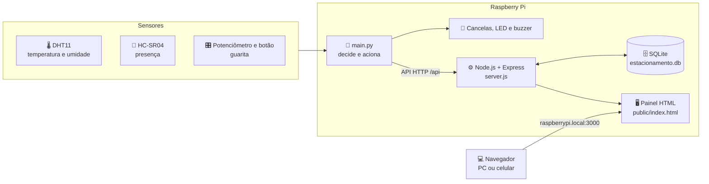


## <a id="funcionalidades"></a>✨ Funcionalidades

| | Função | Como funciona |
| :--: | --- | --- |
| 🟡 | **Entrada** | Carro a menos de 5 cm, confirmado em duas leituras seguidas. Se há vaga, a cancela abre e fecha 2 s depois que o carro passa. |
| 🔴 | **Lotado** | Com 7 carros dentro, a entrada não abre. LED vermelho e música de lotado. |
| 🟢 | **Saída liberada** | O botão **Liberar saída** no painel abre a cancela de saída por 2 s e conta uma saída. Sem ninguém dentro, o pedido é recusado. |
| 🎛️ | **Modo manual** | O botão da guarita liga o modo manual (LED azul). O potenciômetro move a cancela de saída, e a entrada fica fechada. |
| 🌡️ | **Ambiente** | Temperatura e umidade lidas a cada 30 s e mostradas no painel. |
| 📊 | **Painel** | Vagas disponíveis agora, entradas e saídas da semana, gráfico dos últimos 7 dias e estado do sistema físico. |

<details>
<summary><b>🔎 Regras e valores fixos</b></summary>

| Regra | Valor | Onde mudar |
| --- | --- | --- |
| Número de vagas | 7 | `MAX_VAGAS` em `server.js` |
| Distância de detecção | menor que 5 cm | `LIMIAR_CARRO_CM` em `presenca.py` |
| Confirmação de presença | 2 leituras, a cada 2 s | `PERIODO_PRESENCA` em `main.py` |
| Tempo para fechar a cancela | 2 s | `TEMPO_FECHAR` em `main.py` |
| Intervalo mínimo entre entradas | 6 s | `COOLDOWN_ENTRADA` em `main.py` |
| Leitura do DHT11 | a cada 30 s | `INTERVALO_DHT` em `main.py` |
| Validade de um comando do painel | 30 s | `VALIDADE_COMANDO_S` em `server.js` |

</details>


## <a id="equipe"></a>👥 Equipe e divisão de tarefas

Cada integrante ficou com uma das oito partes do sistema, na ordem da lista de atividades.

| Integrante | 🧩 Tarefa |
| :--- | :--- |
| *Ana Graciano* | 1️⃣ Cancelas (2 servos) |
| *Laís Zanardi* | 2️⃣ Presença (ultrassônico) |
| *Pedro Nascimento* | 3️⃣ Guarita manual (potenciômetro e botão) |
| *Lucas Inácio* | 4️⃣ Sinalização (LED RGB e buzzer) |
| *João Moura* | 5️⃣ Ambiente (DHT11) |
| *Gustavo Rosa* | 6️⃣ Lógica (`main.py`) |
| *João Silva* | 7️⃣ Backend (Node.js e SQLite) |
| *Enzo Gabriel de Paula* | 8️⃣ Frontend (painel web) |


## <a id="status"></a>📌 Status

| Parte | Situação | Observação |
| --- | :--: | --- |
| 🧠 Controle (`main.py`) | ✅ | Testado com as peças reais na Raspberry |
| 🚧 Cancelas, sensor, guarita, LED e DHT11 | ✅ | Cada peça testada isoladamente |
| ⚙️ Servidor e API | ✅ | Verificações de contagem, regras de 409 e validade de comandos |
| 🖥️ Painel web | ✅ | Testado no computador e no celular |
| 🔌 Placa de interface | ✅ | Projeto e lista de montagem prontos |
| 📘 Guia da equipe | 🔄 | Código dos trechos atualizado; texto das tarefas em revisão |
| 🗂️ Repositório Git | 🔄 | Estrutura pronta; faltam os commits por parte |


## <a id="hardware"></a>🔌 Hardware

O projeto usa uma **placa de interface** própria, que encaixa no Raspberry e reúne os sensores e atuadores.

<details>
<summary><b>🖼️ Imagem da montagem da placa</b></summary>

<p align="center">
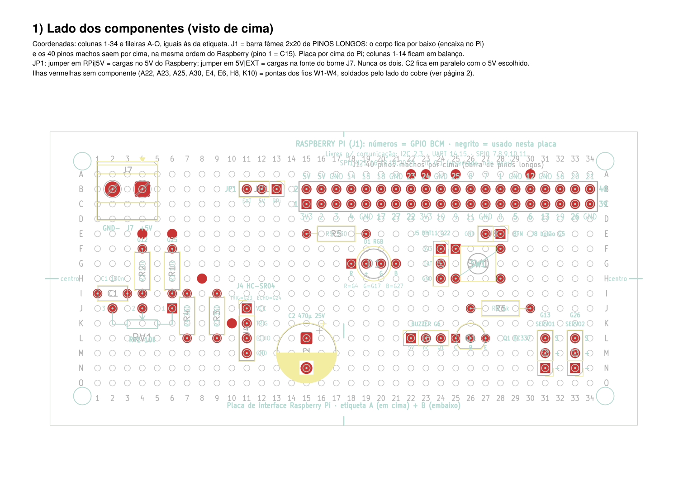
</p>

</details>

<details>
<summary><b>🧵 Trilhas da placa</b></summary>

<p align="center">
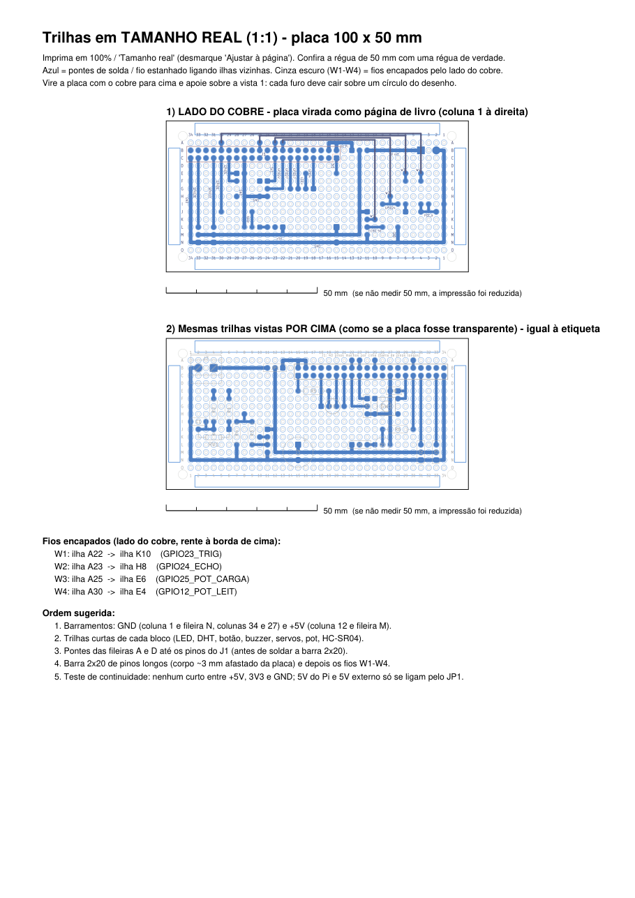
</p>

Arquivos completos: [`trilhas_tamanho_real_A4.pdf`](hardware/trilhas_tamanho_real_A4.pdf) (para conferir em 1:1 sobre a placa) e [`montagem_placa_interface.pdf`](hardware/montagem_placa_interface.pdf) (lado dos componentes, lado do cobre e lista de montagem).

</details>

<details>
<summary><b>📍 Pinos usados (numeração BCM)</b></summary>

| Peça | GPIO (pino físico) |
| --- | --- |
| 🚧 Servo 1, cancela de entrada | 13 (33) |
| 🚧 Servo 2, cancela de saída | 26 (37) |
| 📏 HC-SR04: TRIG e ECHO | 23 (16) e 24 (18) |
| 💡 LED RGB: vermelho, verde, azul | 4 (7), 17 (11), 27 (13) |
| 🔔 Buzzer, por transistor | 6 (31) |
| 🔘 Botão | 5 (29) |
| 🎛️ Potenciômetro: carrega e lê | 12 (32) e 25 (22) |
| 🌡️ DHT11 | 22 (15) |

A fonte da verdade do hardware é `hardware/gerador/design.py`. No software, os pinos ficam em `codigo/sistema/pinos.py`.

</details>


## <a id="projeto-fisico"></a>🔧 Projeto físico

O projeto físico foi feito em duas etapas: primeiro a **bancada de testes**, com os componentes soltos sobre a base de papelão, e depois o **protótipo montado**, com a maquete, o painel e o vídeo de demonstração.

### 🧪 Etapa 1: bancada, antes da prototipação

O Raspberry Pi com a placa de interface, os dois servos das cancelas e o sensor ultrassônico, fixados sobre a base de papelão para validar as ligações.

<details>
<summary><b>📷 Fotos da bancada</b></summary>

<table>
<tr>
<td align="center">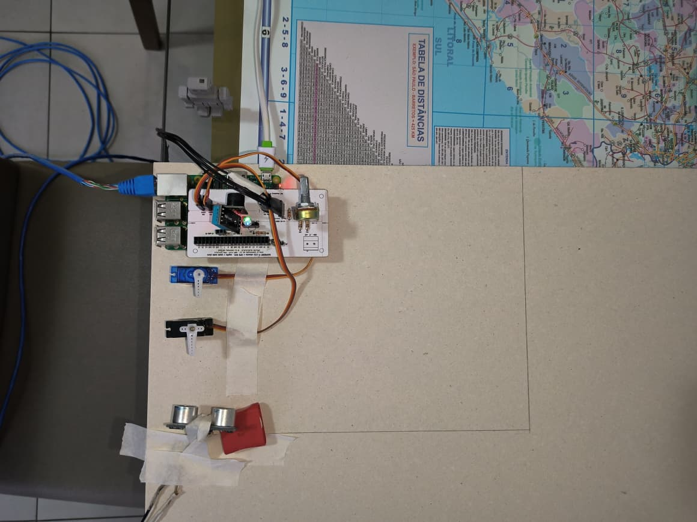<br><sub>Visão geral: Pi, placa, servos e sensor</sub></td>
<td align="center">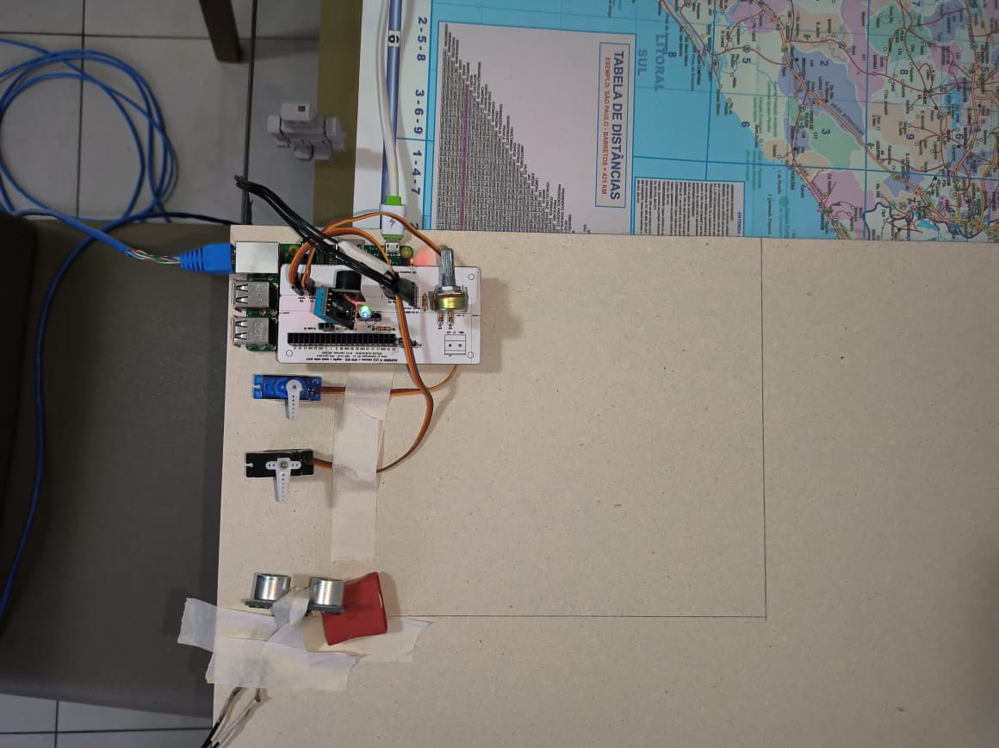<br><sub>Vista de cima sobre a base</sub></td>
</tr>
<tr>
<td align="center">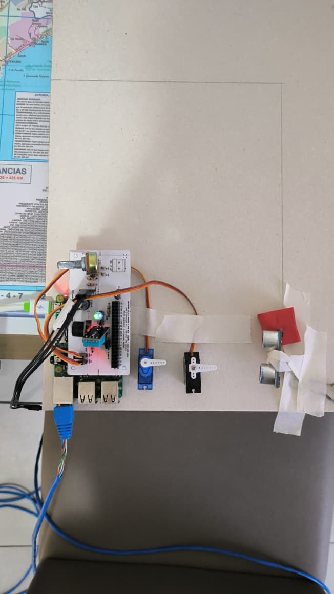<br><sub>Vista lateral: placa e servos</sub></td>
<td align="center">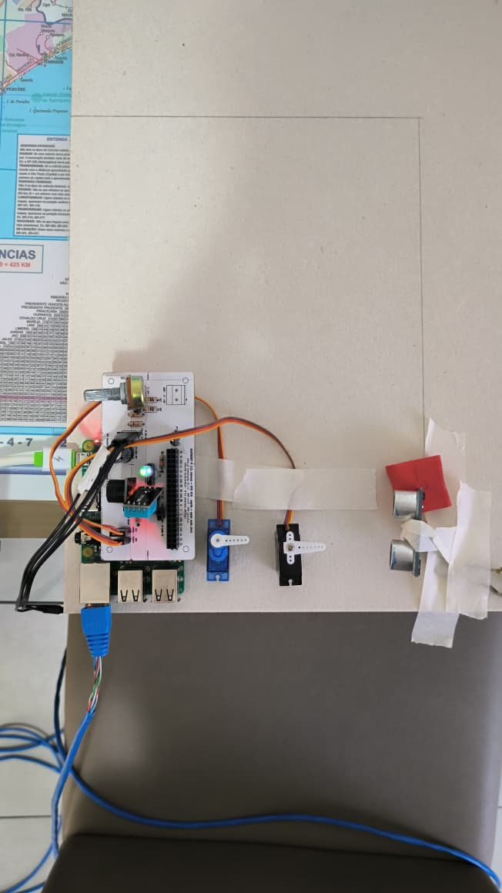<br><sub>Vista lateral aproximada</sub></td>
</tr>
</table>

</details>

<details>
<summary><b>🧰 Fotos dos materiais (EVA preto e branco)</b></summary>

<table>
<tr>
<td align="center">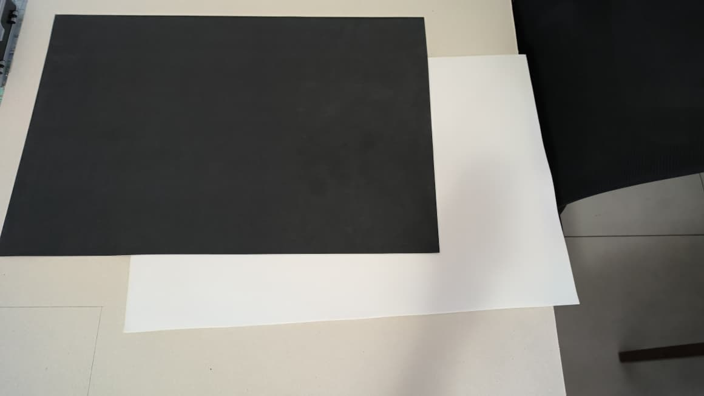<br><sub>EVA preto e branco</sub></td>
<td align="center">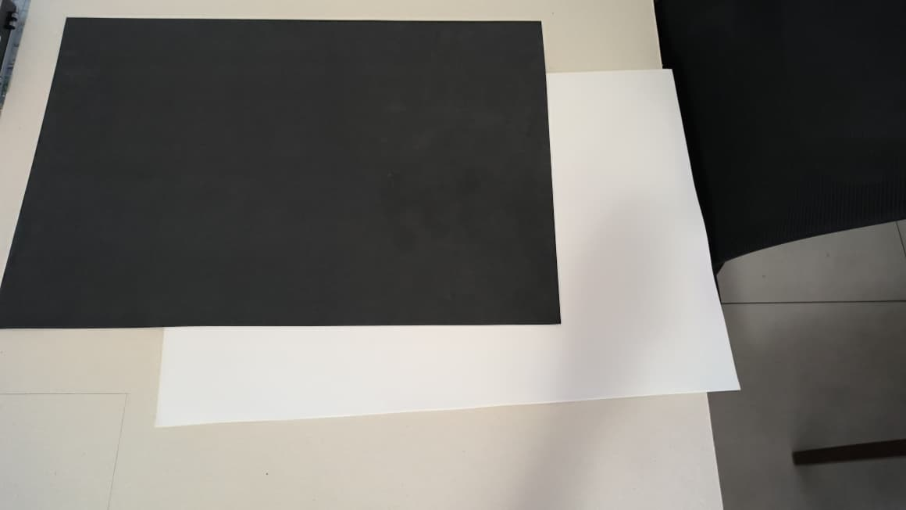<br><sub>Detalhe do material</sub></td>
</tr>
</table>

</details>

### 🏁 Etapa 2: protótipo montado

Com o painel no notebook, a maquete e as cancelas em funcionamento.

<details>
<summary><b>📷 Fotos do protótipo montado</b></summary>

<table>
<tr>
<td align="center">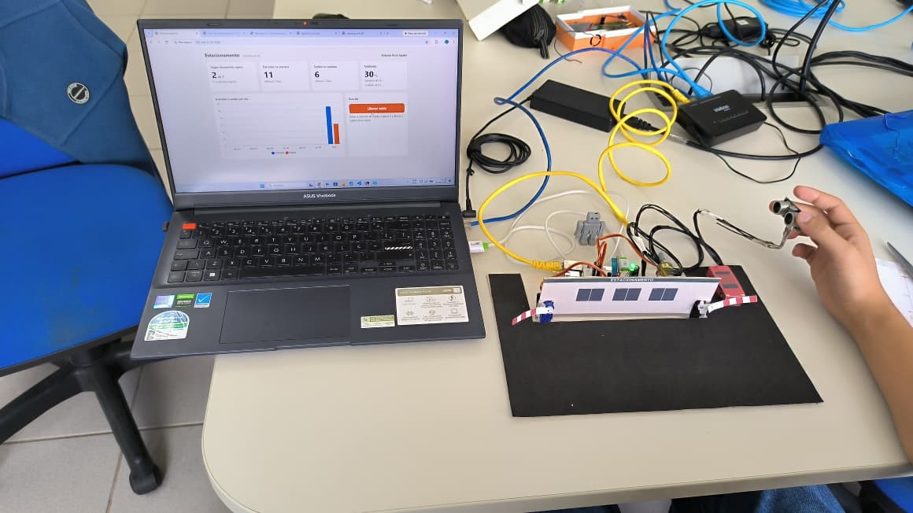<br><sub>Painel no notebook e maquete em funcionamento</sub></td>
<td align="center">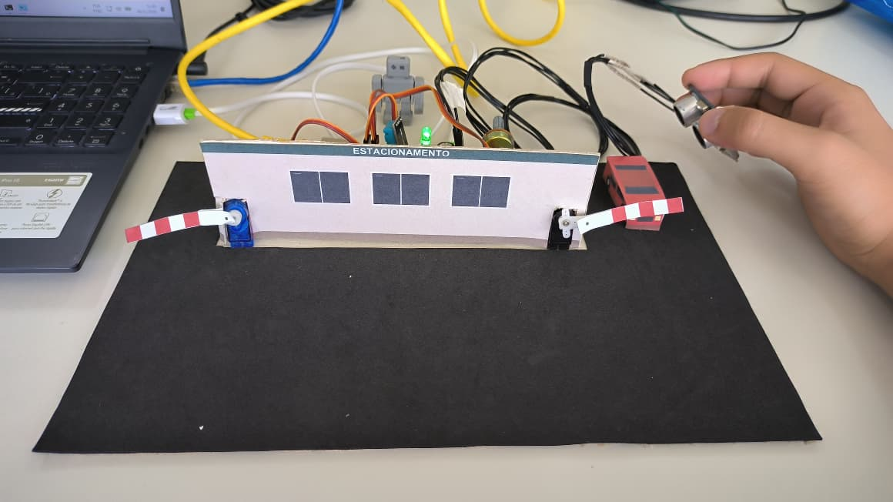<br><sub>Detalhe da maquete</sub></td>
</tr>
</table>

</details>

**▶️ [Assistir ao vídeo do protótipo funcionando](docs/projeto_fisico/video/demonstracao-projeto-fisico.mp4)** (10,8 MB, abre no player do GitHub)


## <a id="executar"></a>🛠️ Como executar

### 1️⃣ No Raspberry (sistema completo)

Os arquivos ficam em `~/codigos/final`.

```bash
# uma vez: instalar as dependências do servidor
cd ~/codigos/final && npm install

# servidor e painel (não mexe nas peças físicas)
./web.sh start            # depois abra http://raspberrypi.local:3000

# parte física (move cancelas, LED e buzzer)
python3 -u main.py        # Ctrl+C para parar
```

Para rodar tudo sozinho ao ligar o Raspberry, use os serviços `estacionamento-web.service` e `estacionamento.service` (veja o guia).

### 2️⃣ Testar uma peça por vez

```bash
cd ~/codigos/final
python3 teste_isolado.py led      # também: buzzer, servo_entrada, servo_saida,
                                  #        botao, pot, distancia, dht
```

> ⚠️ Pare o `main.py` antes de testar uma peça. Dois programas não podem usar os mesmos pinos ao mesmo tempo. Se aparecer `GPIO not allocated`, há outra instância do `main.py` rodando.

<details>
<summary><b>🔁 Gerar de novo o guia e os arquivos da placa</b></summary>

```bash
# guia (precisa só de Python 3)
cd guia/gerador && python3 montar.py

# placa (precisa do KiCad 10 e do PyMuPDF)
cd hardware/gerador
"C:\Program Files\KiCad\10.0\bin\python.exe" gerar_placa.py ../
python exportar.py ../
```

</details>


## <a id="api"></a>🔗 API

| Método e caminho | Quem usa | Para que serve |
| --- | :--: | --- |
| `POST /api/eventos` | 🧠 `main.py` | Conta uma entrada ou saída (409 se saída sem ninguém dentro) |
| `GET /api/resumo` | 🖥️ painel e 🧠 `main.py` | Dentro, vagas, entradas e saídas da semana, por dia |
| `POST /api/ambiente` | 🧠 `main.py` | Guarda uma leitura do DHT11 |
| `GET /api/ambiente/ultima` | 🖥️ painel | Última temperatura e umidade |
| `POST /api/comandos` | 🖥️ painel | Pede a liberação da saída |
| `GET /api/comandos/proximo` | 🧠 `main.py` | Entrega o próximo comando (204 se não há nenhum) |

<details>
<summary><b>📁 O que tem em <code>codigo/sistema/</code></b></summary>

| Arquivo | Função |
| --- | --- |
| `main.py` | Controle principal: decide, aciona e registra |
| `cancelas.py` | Servos das cancelas (PWM) |
| `presenca.py` | Sensor ultrassônico |
| `manual.py` | Potenciômetro e botão da guarita |
| `sinais.py` | LED RGB e buzzer |
| `ambiente.py` | DHT11, lido com `libgpiod` (sem `pip`) |
| `pinos.py` | Pinos da placa em um lugar só |
| `server.js` | Backend (Node.js + Express + SQLite) |
| `public/index.html` | Painel web |
| `teste_isolado.py` | Testa uma peça por vez |
| `web.sh` | Liga e desliga o servidor e o painel |
| `*.service` | Serviços para rodar em segundo plano |

</details>


## <a id="maquete"></a>🧱 Maquete

A maquete representa o estacionamento onde o sistema roda. Ela é feita só com papelão, EVA e papel impresso, e desmonta em peças planas que cabem numa pasta de arquivos.

| O que tem | Onde está |
| --- | --- |
| 📖 Passo a passo (imprimir, cortar, montar e guardar) | [`maquete/LEIA-ME.md`](maquete/LEIA-ME.md) |
| 🧭 Proposta e decisões (versão 5, só com tesoura) | [`maquete/FASE1_proposta.md`](maquete/FASE1_proposta.md) |
| 🎲 Vista 3D no navegador | [`maquete/maquete_3d.html`](maquete/maquete_3d.html) |
| 📐 Planta cotada | [`maquete/previas/planta_v5.png`](maquete/previas/planta_v5.png) |
| 🖨️ Arquivos para imprimir | [`maquete/impressao/`](maquete/impressao/) |
| ⚙️ Gerador (todas as medidas em `design.py`) | [`maquete/gerador/`](maquete/gerador/) |

<details>
<summary><b>🧰 O que você precisa</b></summary>

- Papelão de 2,5 mm (cerca de 0,23 m² da chapa)
- EVA preto de 1 mm (311 × 200 mm)
- 1 folha de etiquetas PIMACO 6282
- Fita crepe, cola branca, cola bastão, tesoura, régua e alfinete

</details>

**Regra da versão 5:** todo corte começa na borda da peça e nenhum recorte tem menos de 10 mm de largura, para dar para cortar só com tesoura. Os encaixes viraram dobradiças de fita crepe, tiras coladas e carros colados.

Para gerar de novo os arquivos a partir das medidas, rode na pasta `maquete/gerador/`:

```bash
python -B design.py
python -B conferir.py
python -B gerar_3d.py ../maquete_3d.html
python -B gerar_gabaritos.py ../impressao
python -B gerar_adesivos.py ../impressao
python -B conferir_pdf.py ../impressao
```


## <a id="testes"></a>🧪 Testes realizados

- ✅ **API:** contagem de eventos, recusa de saída sem ninguém dentro, validade de comandos antigos e leituras de ambiente.
- ✅ **Painel:** renderizado no navegador do computador e em 380 px de largura (celular).
- ✅ **Peças físicas:** cada uma testada isoladamente na Raspberry.
- ✅ **Controle:** `main.py` rodado primeiro com cancelas e LED simulados, depois com as peças reais.


## <a id="documentacao"></a>📚 Documentação

| Página | O que tem |
| --- | --- |
| 📘 [Guia da equipe](guia/index.html) | Passo a passo de cada tarefa, com figuras |
| 📦 [Transferência](docs/transferencia.md) | O que tem no repositório e como usar cada parte |
| 🧾 [Lista de materiais](docs/lista_de_materiais.csv) | Componentes da placa |
| 🔗 [Netlist](docs/ligacoes_netlist.csv) | Ligações elétricas da placa |


<p align="center"><a href="#topo">⬆️ Voltar ao topo</a></p>


