<a id="topo"></a>

<h1 align="center">🅿️ Estacionamento Inteligente</h1>

<p align="center">
Raspberry Pi, sensores e um painel web para controlar entradas, saídas e vagas.
</p>

<p align="center">


</p>

<p align="center">
<br>
<sub>Primeiro protótipo</sub>
</p>

<p align="center">
<a href="docs/projeto_fisico/video/demonstracao-projeto-fisico.mp4"><b>▶️ Vídeo</b></a> &nbsp;·&nbsp;
<a href="codigo/sistema/"><b>💻 Código</b></a> &nbsp;·&nbsp;
<a href="guia/guia_equipe.pdf"><b>📘 Guia (PDF)</b></a> &nbsp;·&nbsp;
<a href="maquete/"><b>🧱 Maquete</b></a>
</p>

---

## 🎯 Sobre o projeto

Projeto da atividade **Apresentação do projeto Raspberry**. O caso escolhido é um **estacionamento de supermercado**, em que o que importa é a **saída**: quem sai precisa estar liberado (no protótipo, pelo painel ou pelo potenciômetro da guarita).

| 🚗 Entrada | 🚧 Saída | 🖥️ Painel |
| :-- | :-- | :-- |
| O sensor percebe o carro. Se há vaga, a cancela abre e fecha depois que o carro passa. | O porteiro libera a saída pelo painel ou pela guarita. | Vagas livres, movimento da semana e temperatura do pátio. |

---

## 🧭 Como funciona

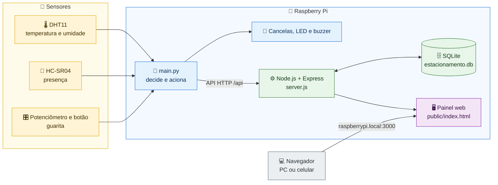

**Em ordem, o que acontece:**

1. 🚗 Um carro chega à entrada e o sensor percebe.
2. 🧠 A Raspberry decide: se há vaga, abre a cancela. Se está lotado, acende o LED vermelho.
3. ⚙️ A Raspberry registra a entrada ou saída no servidor.
4. 🖥️ O painel atualiza as vagas, e a pessoa vê tudo no navegador.

> 🎨 **Cores:** 🟡 sensores · 🔵 Raspberry Pi · 🟢 servidor e banco · 🟣 painel · ⚪ navegador


---

## 👥 Trabalho em equipe

| Integrante | Tarefa | Redes |
| :-- | :-- | :-- |
| *Ana Graciano* | 1️⃣ Cancelas | [](https://github.com/Ane-Graciano) [](https://www.linkedin.com/in/ana-graciano/) |
| *Laís Zanardi* | 2️⃣ Presença | [](https://github.com/lais-zanardi) [](https://www.linkedin.com/in/lais-zanardi-inocencio/) |
| *Pedro Nascimento* | 3️⃣ Guarita manual | [](https://github.com/P3dr0213) [](https://www.linkedin.com/in/pedro-nascimento-87a22937a/) |
| *Lucas Inácio* | 4️⃣ Sinalização | [](https://github.com/Lukitta013) [](https://www.linkedin.com/in/luucasinacioo/) |
| *João Moura* | 5️⃣ Ambiente | [](https://github.com/JoaooMoura) [](https://www.linkedin.com/in/joaoomoura/) |
| *Gustavo Rosa* | 6️⃣ Lógica | [](https://github.com/gustasvos) [](https://www.linkedin.com/in/gustavo-rosa-46a251180/) |
| *João Silva* | 7️⃣ Backend | [](https://github.com/kakashinho) [](https://www.linkedin.com/in/joao-vitor-siqueira-a2a2a3227/) |
| *Enzo Gabriel de Paula* | 8️⃣ Frontend | [](https://github.com/EnzoGabrielCode) [](https://www.linkedin.com/in/enzo-gabriel-de-paula-8795a8332/) |

---

## 🔧 Como ficou na prática

<p align="center">
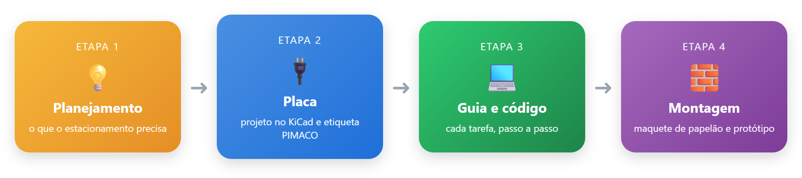<br>
<sub>Fluxo de desenvolvimento, na ordem em que foi feito</sub>
</p>

<p align="center">
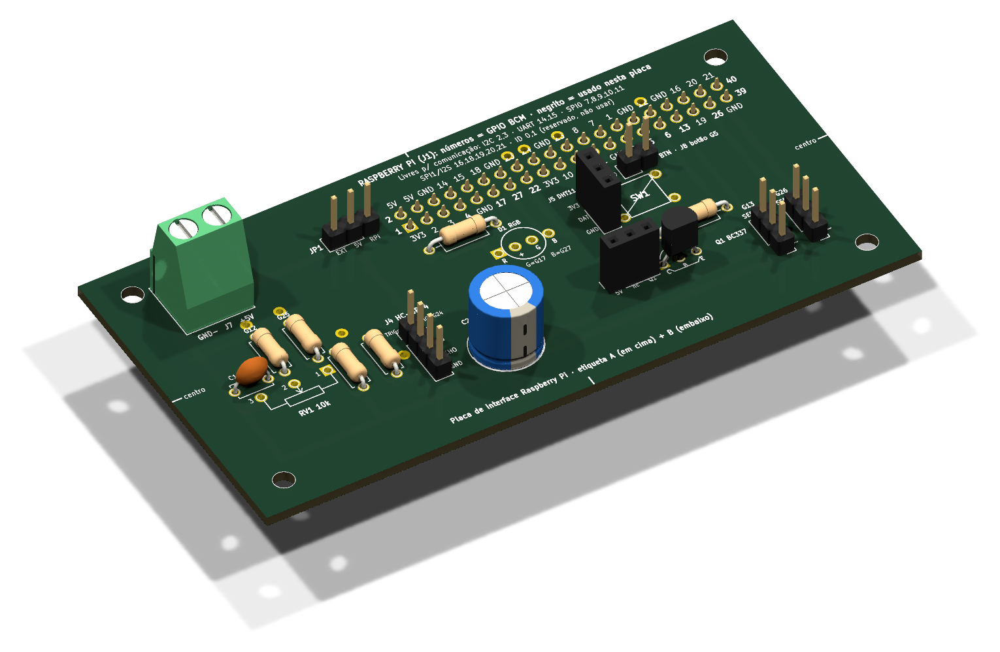<br>
<sub>Placa de interface em 3D, feita no KiCad, com a etiqueta PIMACO</sub>
</p>

<details>
<summary><b>▶️ Ver a placa de outros ângulos</b></summary>

<table align="center">
<tr>
<td align="center">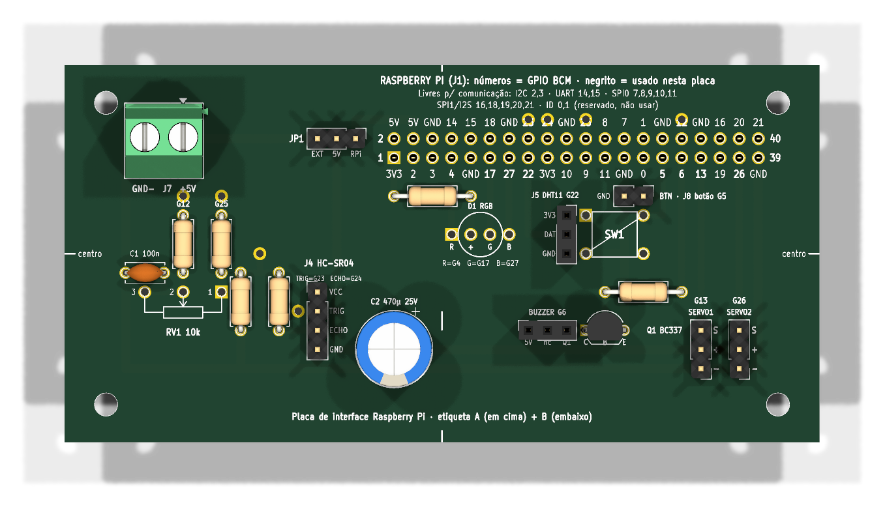<br><sub>Vista de cima</sub></td>
<td align="center">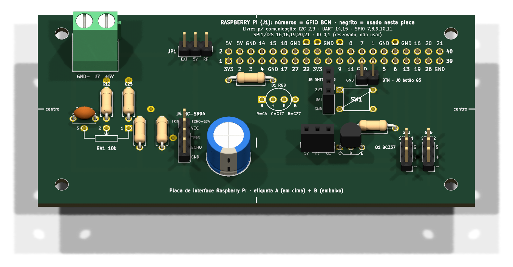<br><sub>Vista inclinada</sub></td>
</tr>
<tr>
<td align="center">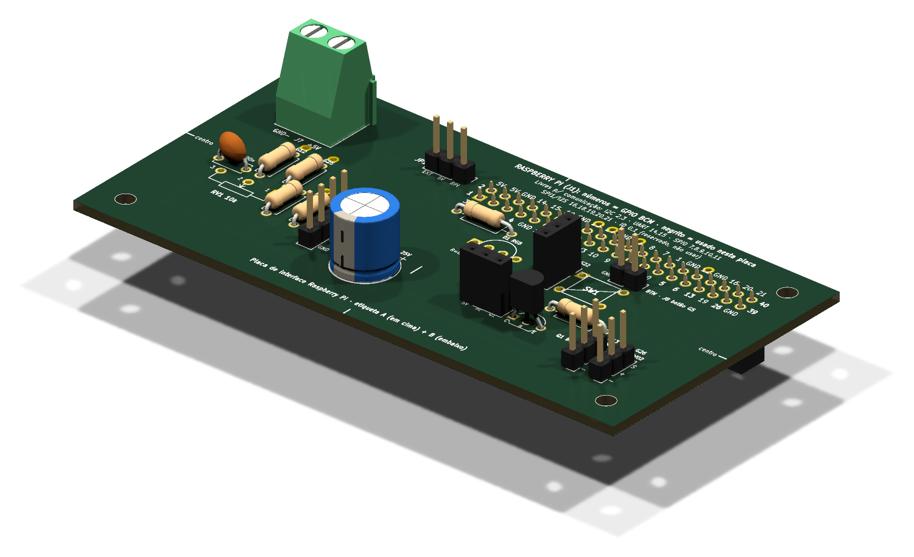<br><sub>Lado esquerdo</sub></td>
<td align="center">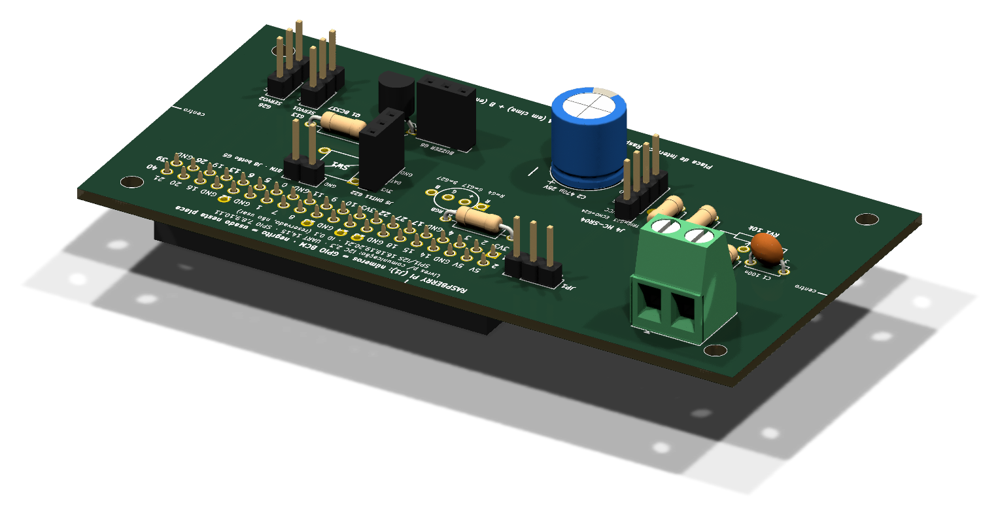<br><sub>Lado direito</sub></td>
</tr>
</table>

</details>

<details>
<summary><b>▶️ Antes da montagem: a bancada de testes</b></summary>

<table>
<tr>
<td align="center"><br><sub>Pi, placa, servos e sensor</sub></td>
<td align="center"><br><sub>Vista de cima</sub></td>
</tr>
<tr>
<td align="center"><br><sub>Vista lateral</sub></td>
<td align="center"><br><sub>Materiais: EVA preto e branco</sub></td>
</tr>
</table>

</details>

<details>
<summary><b>▶️ Depois da montagem: o protótipo completo</b></summary>

<table>
<tr>
<td align="center"><br><sub>Detalhe da maquete</sub></td>
<td align="center"><br><sub>Painel web</sub></td>
</tr>
</table>

</details>

---

## 🧱 Projeto de montagem da maquete

O projeto que mostra como montar a maquete. Usa só papelão, EVA e papel impresso, e as peças são planas, para caberem numa pasta.

<p align="center">
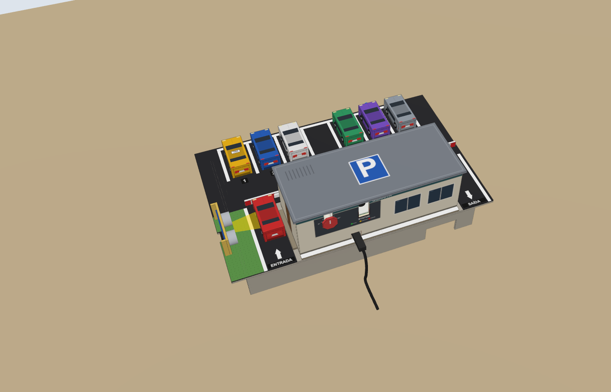<br>
<sub>Para girar o modelo, abra <a href="maquete/maquete_3d.html">maquete_3d.html</a></sub>
</p>

<details>
<summary><b>🔍 Mais ângulos da maquete</b></summary>

<table align="center">
<tr>
<td align="center">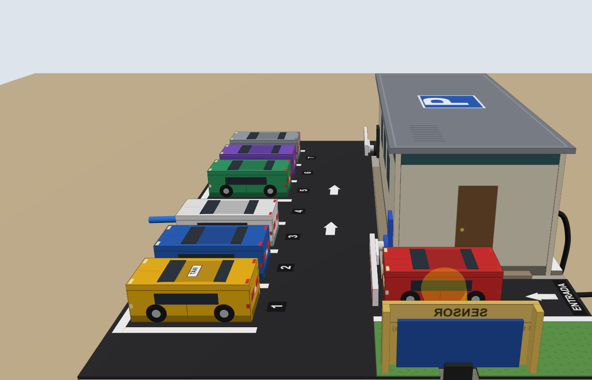<br><sub>Lado da entrada</sub></td>
<td align="center">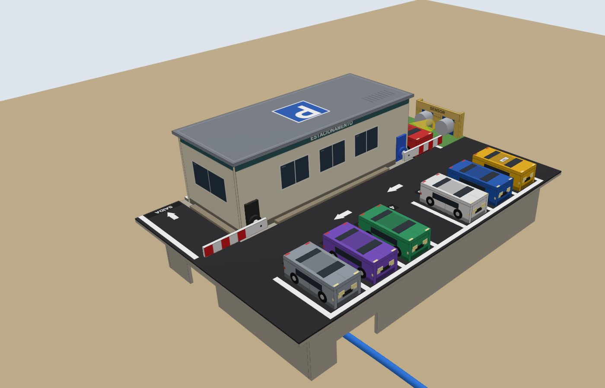<br><sub>Por trás, em diagonal</sub></td>
</tr>
<tr>
<td align="center">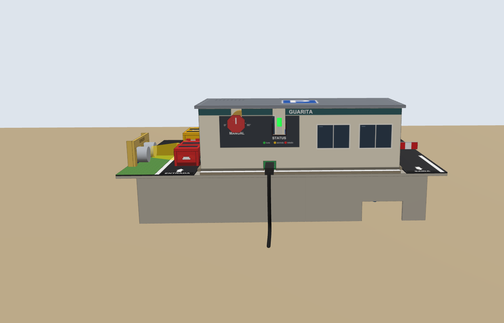<br><sub>Frente da guarita</sub></td>
<td align="center">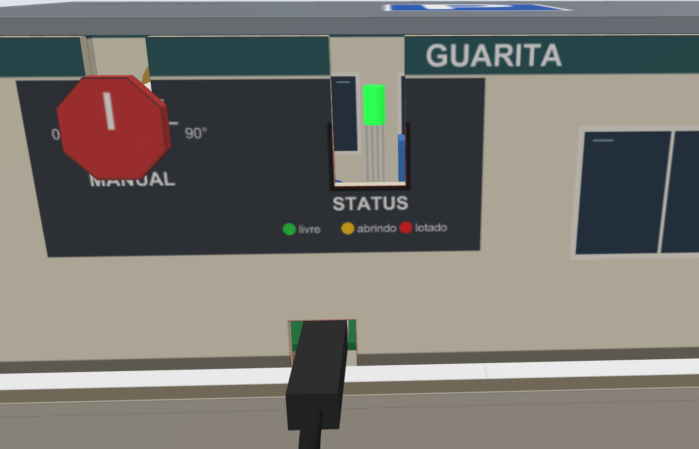<br><sub>Painel de perto (MANUAL e STATUS)</sub></td>
</tr>
</table>

</details>

- 📖 [Passo a passo para montar](maquete/LEIA-ME.md)
- 🧭 [Proposta e decisões](maquete/FASE1_proposta.md)
- 🖨️ [Arquivos para imprimir](maquete/impressao/)

---

## 🚀 Como rodar o sistema

Os comandos ficam na pasta [`codigo/sistema/`](codigo/sistema/), e rodam na Raspberry Pi com a placa de interface:

```bash
npm install            # só na primeira vez
./web.sh start         # painel em http://raspberrypi.local:3000
python3 -u main.py     # parte física (cancelas, LED e buzzer)
```

<details>
<summary><b>🧪 Testar uma peça por vez</b></summary>

```bash
python3 teste_isolado.py led     # também: buzzer, servo_entrada, servo_saida, botao, pot, distancia, dht
```

Pare o `main.py` antes de testar uma peça.

</details>

---

## 📚 Onde ler mais

| Documento | Para que serve |
| :-- | :-- |
| 📘 [Guia da equipe](guia/index.html) | Passo a passo de cada tarefa, com figuras |
| 📕 [Guia em PDF](guia/guia_equipe.pdf) | A mesma versão, para imprimir |
| 📦 [Transferência](docs/transferencia.md) | O que tem no repositório e como usar cada parte |
| 🧾 [Lista de materiais](docs/lista_de_materiais.csv) | Componentes da placa |
| 🔌 [Placa de interface](hardware/README.md) | Projeto da placa no KiCad, arquivos e etiquetas |
| 🧪 [Códigos de partida](codigo/starter/README.md) | Um esqueleto por tarefa, para começar |
| ⚙️ [Código final](codigo/sistema/README.md) | O sistema que roda na Raspberry Pi |

---

<details>
<summary><b>🔎 Saiba mais</b></summary>

<p align="center">
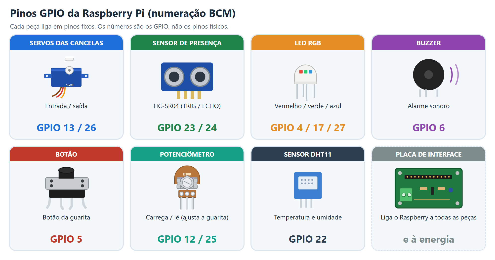<br>
<sub>Pinos GPIO usados pela placa, na numeração BCM</sub>
</p>

<p align="center">
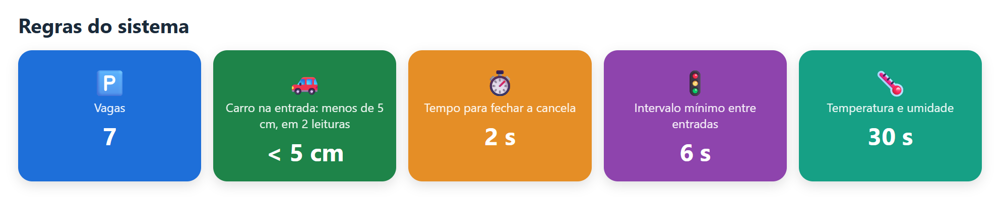<br>
<sub>Regras de funcionamento do sistema</sub>
</p>

<p align="center">
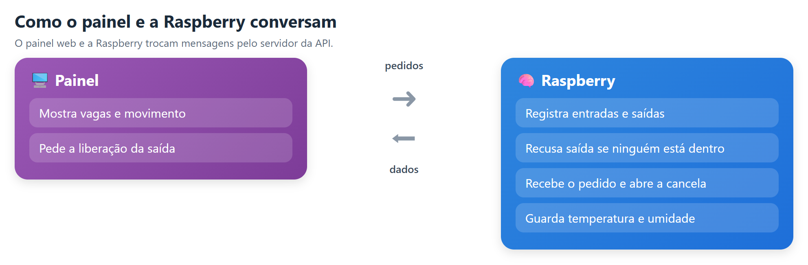<br>
<sub>Quem faz cada ação no painel e na Raspberry</sub>
</p>
<p align="center">As rotas exatas estão em <a href="codigo/sistema/server.js"><code>codigo/sistema/server.js</code></a>.</p>


<p align="center">
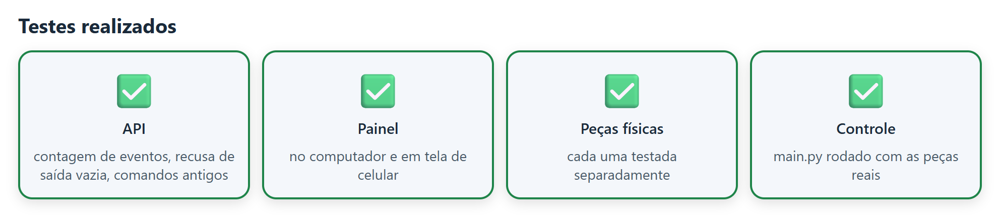<br>
<sub>Testes feitos antes da entrega</sub>
</p>

<p align="center">
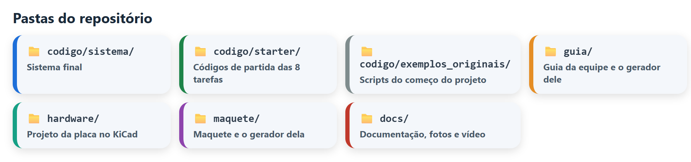<br>
<sub>Pastas do repositório: o que cada uma guarda</sub>
</p>

</details>

---

<p align="center"><a href="#topo">⬆️ Voltar ao topo</a></p>
