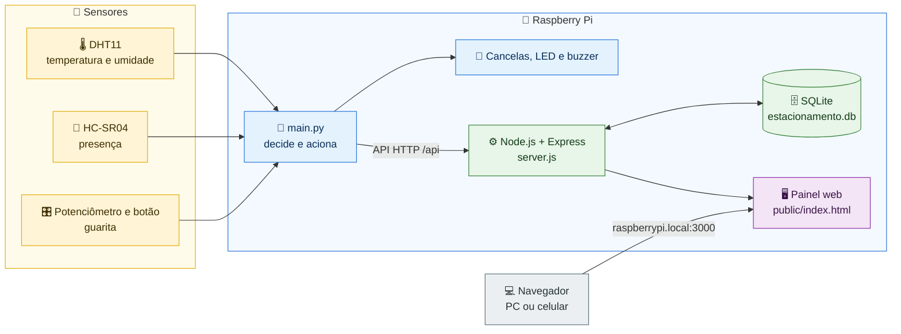
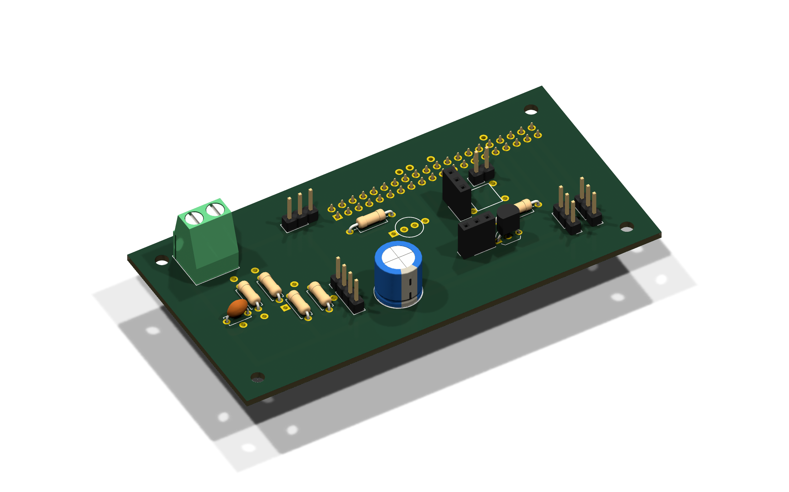
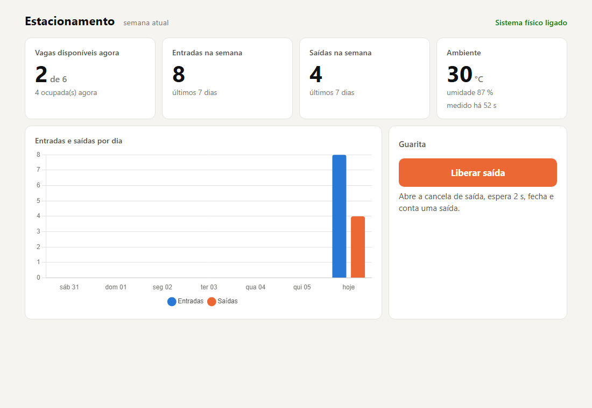
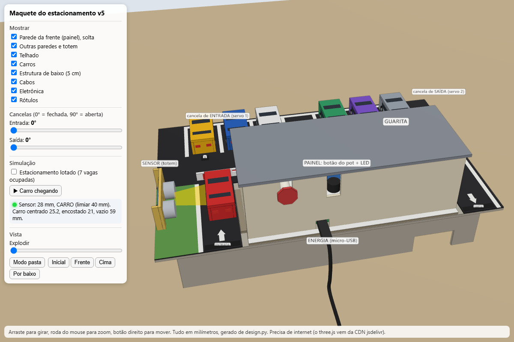

<a id="topo"></a>

<h1 align="center">🅿️ Estacionamento Inteligente</h1>

<p align="center">
Raspberry Pi, sensores e um painel web para controlar entradas, saídas e vagas.
</p>

<p align="center">


</p>

<p align="center">

</p>

<p align="center">
<a href="docs/projeto_fisico/video/demonstracao-projeto-fisico.mp4"><b>▶️ Vídeo</b></a> &nbsp;·&nbsp;
<a href="codigo/sistema/"><b>💻 Código</b></a> &nbsp;·&nbsp;
<a href="guia/guia_equipe.pdf"><b>📘 Guia (PDF)</b></a> &nbsp;·&nbsp;
<a href="maquete/"><b>🧱 Maquete</b></a>
</p>

---

## 🎯 Sobre o projeto

Projeto da atividade **Apresentação do projeto Raspberry**. O caso escolhido é um **estacionamento de supermercado**, em que o que importa é a **saída**: quem sai precisa estar liberado (no protótipo, pelo painel ou pelo potenciômetro da guarita).

| 🚗 Entrada | 🚧 Saída | 🖥️ Painel |
| :-- | :-- | :-- |
| O sensor percebe o carro. Se há vaga, a cancela abre e fecha depois que o carro passa. | O porteiro libera a saída pelo painel ou pela guarita. | Vagas livres, movimento da semana e temperatura do pátio. |

---

## 🧭 Como funciona



**Em ordem, o que acontece:**

1. 🚗 Um carro chega à entrada e o sensor percebe.
2. 🧠 A Raspberry decide: se há vaga, abre a cancela. Se está lotado, acende o LED vermelho.
3. ⚙️ A Raspberry registra a entrada ou saída no servidor.
4. 🖥️ O painel atualiza as vagas, e a pessoa vê tudo no navegador.

> 🎨 **Cores:** 🟡 sensores · 🔵 Raspberry Pi · 🟢 servidor e banco · 🟣 painel · ⚪ navegador


---

## 👥 Quem fez o quê

| Integrante | Tarefa | Redes |
| :-- | :-- | :-- |
| *Ana Graciano* | 1️⃣ Cancelas | [](https://github.com/Ane-Graciano) [](https://www.linkedin.com/in/ana-graciano/) |
| *Laís Zanardi* | 2️⃣ Presença | [](https://github.com/lais-zanardi) [](https://www.linkedin.com/in/lais-zanardi-inocencio/) |
| *Pedro Nascimento* | 3️⃣ Guarita manual | [](https://github.com/P3dr0213) [](https://www.linkedin.com/in/pedro-nascimento-87a22937a/) |
| *Lucas Inácio* | 4️⃣ Sinalização | [](https://github.com/Lukitta013) [](https://www.linkedin.com/in/luucasinacioo/) |
| *João Moura* | 5️⃣ Ambiente | [](https://github.com/JoaooMoura) [](https://www.linkedin.com/in/joaoomoura/) |
| *Gustavo Rosa* | 6️⃣ Lógica | [](https://github.com/gustasvos) [](https://www.linkedin.com/in/gustavo-rosa-46a251180/) |
| *João Silva* | 7️⃣ Backend | [](https://github.com/kakashinho) [](https://www.linkedin.com/in/joao-vitor-siqueira-a2a2a3227/) |
| *Enzo Gabriel de Paula* | 8️⃣ Frontend | [](https://github.com/EnzoGabrielCode) [](https://www.linkedin.com/in/enzo-gabriel-de-paula-8795a8332/) |

---

## 🔧 Como ficou na prática

Primeiro montamos tudo sobre uma base de papelão, para testar as ligações. Depois veio o protótipo completo, com a maquete e o painel.

<p align="center">
<br>
<sub>Placa de interface em 3D, feita no KiCad</sub>
</p>

<details>
<summary><b>📷 Fotos da bancada (antes do protótipo)</b></summary>

<table>
<tr>
<td align="center"><br><sub>Pi, placa, servos e sensor</sub></td>
<td align="center"><br><sub>Vista de cima</sub></td>
</tr>
<tr>
<td align="center"><br><sub>Vista lateral</sub></td>
<td align="center"><br><sub>Materiais: EVA preto e branco</sub></td>
</tr>
</table>

</details>

<details>
<summary><b>📷 Fotos do protótipo montado</b></summary>

<table>
<tr>
<td align="center"><br><sub>Detalhe da maquete</sub></td>
<td align="center"><br><sub>Painel web</sub></td>
</tr>
</table>

</details>

---

## 🧱 Maquete de papelão

Feita só com papelão, EVA e papel impresso. Ela desmonta em peças planas que cabem numa pasta.

<p align="center">
<br>
<sub>Vista 3D: abra <a href="maquete/maquete_3d.html">maquete_3d.html</a> para girar o modelo</sub>
</p>

- 📖 [Passo a passo para montar](maquete/LEIA-ME.md)
- 🧭 [Proposta e decisões](maquete/FASE1_proposta.md)
- 🖨️ [Arquivos para imprimir](maquete/impressao/)

---

## 🚀 Como rodar no Raspberry

No Raspberry, a partir da pasta `~/codigos/final`:

```bash
npm install            # só na primeira vez
./web.sh start         # painel em http://raspberrypi.local:3000
python3 -u main.py     # parte física (cancelas, LED e buzzer)
```

<details>
<summary><b>🧪 Testar uma peça por vez</b></summary>

```bash
python3 teste_isolado.py led     # também: buzzer, servo_entrada, servo_saida, botao, pot, distancia, dht
```

Pare o `main.py` antes de testar uma peça.

</details>

---

## 📚 Onde ler mais

| Documento | Para que serve |
| :-- | :-- |
| 📘 [Guia da equipe](guia/index.html) | Passo a passo de cada tarefa, com figuras |
| 📕 [Guia em PDF](guia/guia_equipe.pdf) | A mesma versão, para imprimir |
| 📦 [Transferência](docs/transferencia.md) | O que tem no repositório e como usar cada parte |
| 🧾 [Lista de materiais](docs/lista_de_materiais.csv) | Componentes da placa |

---

<details>
<summary><b>🔎 Saiba mais</b></summary>

### Pinos (numeração BCM)

| Peça | GPIO |
| :-- | :-- |
| Servo da entrada / da saída | 13 / 26 |
| Ultrassônico (TRIG / ECHO) | 23 / 24 |
| LED RGB (vermelho / verde / azul) | 4 / 17 / 27 |
| Buzzer | 6 |
| Botão | 5 |
| Potenciômetro (carrega / lê) | 12 / 25 |
| DHT11 | 22 |

### Regras do sistema

| Regra | Valor |
| :-- | :-- |
| Vagas | 7 |
| Carro na entrada | menos de 5 cm, confirmado em duas leituras |
| Tempo para fechar a cancela | 2 s |
| Intervalo mínimo entre entradas | 6 s |
| Leitura de temperatura e umidade | a cada 30 s |

### API (como o painel e a Raspberry conversam)

| O que acontece | Quem faz |
| :-- | :--: |
| Registra uma entrada ou saída | 🧠 Raspberry |
| Recusa saída se não há ninguém dentro | 🧠 Raspberry |
| Mostra vagas e movimento no painel | 🖥️ Painel |
| Guarda temperatura e umidade | 🧠 Raspberry |
| Pede a liberação da saída | 🖥️ Painel |
| Recebe o pedido e abre a cancela | 🧠 Raspberry |

As rotas exatas estão em [`codigo/sistema/server.js`](codigo/sistema/server.js).

### Testes realizados

- ✅ API: contagem de eventos, recusa de saída sem ninguém dentro e comandos antigos.
- ✅ Painel: no computador e em tela de celular.
- ✅ Peças físicas: cada uma testada separadamente.
- ✅ Controle: `main.py` rodado com as peças reais.

### Pastas do repositório

| Pasta | Conteúdo |
| :-- | :-- |
| `codigo/sistema/` | Sistema final |
| `codigo/starter/` | Códigos de partida das 8 tarefas |
| `codigo/exemplos_originais/` | Scripts do começo do projeto |
| `guia/` | Guia da equipe e o gerador dele |
| `hardware/` | Projeto da placa no KiCad |
| `maquete/` | Maquete e o gerador dela |
| `docs/` | Documentação, fotos e vídeo |

</details>

---

<p align="center"><a href="#topo">⬆️ Voltar ao topo</a></p>
